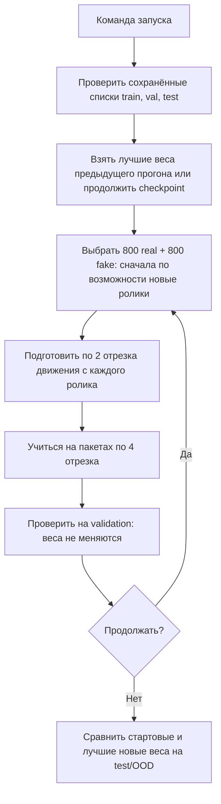
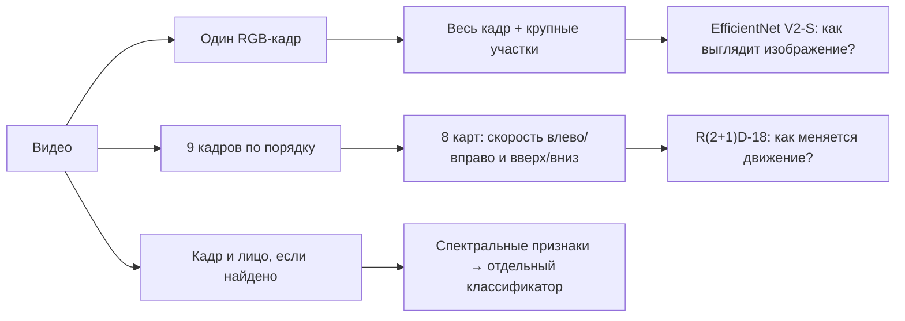
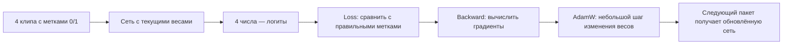

# Как обучаются модели TRACE

## Движение лица на DFDC

Следующий изолированный эксперимент сравнивает текущую модель движения по
всему кадру с моделью, дообученной на движении в области лица. YuNet находит
лицо в исходном кадре. Одна неподвижная рамка охватывает лицо на протяжении
клипа; уже вырезанная область уменьшается, после чего вычисляется поток.
Если лицо не удалось выделить, из этого сравнения исключается вся пара,
а причина и покрытие записываются отдельно. Сайт этот эксперимент не использует.

```powershell
powershell -NoProfile -ExecutionPolicy Bypass -File .\train-temporal.ps1 -FaceTrain
```

Панель: http://127.0.0.1:8767. Логи и сравнение сохраняются в
`cache/temporal_v2/runs/motion_face_dfdc_v1`. В обеих версиях оцениваются
одни и те же поддерживаемые пары, на одинаковых временных позициях.
Пороги подбираются отдельно на общей для них validation с целью не более 5%
ложных тревог; на test доли могут отличаться. Сравнение относится к DFDC
и не показывает качество на других генераторах.

## Следующий эксперимент: пары DFDC

Прогон `motion_coverage_v1` не улучшил стартовые веса: лучшей осталась
эпоха 0. Следующий прогон проверяет другую выборку, а не продолжает с
`last.pt`. Он стартует с выбранного `best.pt`, снова создаёт оптимизатор
и сохраняется отдельно в `cache/temporal_v2/runs/motion_paired_dfdc_v1`.

```powershell
powershell -NoProfile -ExecutionPolicy Bypass -File .\train-motion-paired.ps1
```

План `paired_plan.json` составлен из уже имеющихся видео и проверен.
В каждой из четырёх эпох: 250 связанных пар DFDC и 500 видео других
источников, поровну real/fake. Подделки в парах не встречались среди
примеров стартовых весов и прогона на охват; некоторые оригиналы
повторяются относительно прошлых обучений. Пары и их метки задают
состав выборки, но функция ошибки по-прежнему оценивает каждый отрезок
отдельно. Validation и test оставлены прежними. Основное описание ниже
относится к уже завершённому прогону на охват.

Это описание текущего кода, а не обещание точности. В новом эксперименте
дообучается **только вторая модель**, которая анализирует движение.
Первая и третья модели, а также веса, которыми пользуется сайт, не меняются.

## 1. Что произойдёт после запуска

Запуск из PowerShell в корне проекта:

```powershell
powershell -NoProfile -ExecutionPolicy Bypass -File .\train-motion-coverage.ps1
```

Панель мониторинга: http://127.0.0.1:8766 (точный адрес появится в строке
`DASHBOARD`). Остановка: `Ctrl+C`. Повтор той же команды поднимет состояние
нового эксперимента из контрольной точки; могут повториться до 20 последних
пакетов с момента записи. `-AuditOnly` проверяет план, не обучая сеть.



1. **Данные.** Список роликов уже зафиксирован. Здесь ничего не скачивается и
   оригиналы не переписываются. Train нужен для обучения, validation для
   выбора эпохи и порога, test для сравнения. Связанные оригиналы и подделки
   держим в одном разделе; известные дубли не должны пересекать разделы.
   Это не гарантирует, что обнаружены все похожие ролики.
2. **Старт.** Первый запуск берёт `best.pt` из `final_motion_v1` (эпоха 14)
   и создаёт новый AdamW с меньшим шагом. Это не обучение с нуля и не
   продолжение старого оптимизатора. Повторный запуск читает уже новый
   `checkpoint.pt`, вместе с весами, оптимизатором и позициями в выборке.
3. **Отбор.** В каждом грубом диапазоне разрешения, формы кадра и исходного
   FPS берём поровну real и fake. По возможности берём два новых ролика в
   паре; если такой пары больше нет, разрешаем повтор одной стороны. На одну
   fake-группу источников действует предел 60% фейков за эпоху. Это уменьшает
   перекос, но не уравнивает кодеки, монтаж и сюжеты.
4. **Подготовка и обучение.** FFmpeg декодирует кадры, OpenCV на CPU строит
   оптический поток, а сеть оценивает его и обучается на GPU. Поэтому между
   этапами нагрузка на GPU может опускаться. Локальный кэш ограничен по
   диску; обучающие отрезки прошлых эпох убираются.

Эпоха здесь означает **один проход по выбранной порции**, не по всему архиву.
В прошлом прогоне это было 800 роликов, в новом 1 600, или 3 200 клипов и
800 пакетов на эпоху. В пригодном пуле 33 071 ролик. Ещё 33 183 не прошли
требования по времени или FPS, а 11 302 не имели противоположного класса в
своём диапазоне. Из тех, кто прошёл, план даёт до **12 688 новых для стартовых
весов** за 12 эпох. Это верхняя граница, не отчёт о том, что уже обучено.
Фактический охват смотри по `COVERAGE ACTUAL` и `coverage.json`.

## 2. Что получает каждая модель



**Первая, пространственная.** В нашем последнем обучении из ролика брали два
кадра из разных частей видео. Для каждого сеть видит и уменьшенный целый кадр,
и два случайных локальных участка. Те же виды подаются в двух вариантах:
исходном и с искажениями, например с пережатием. Целый кадр даёт контекст;
участки дают шанс заметить мелкие странности. Целевая функция учит одновременно
классифицировать кадр и меньше менять ответ между двумя версиями. Сложные
примеры могут получить больший вес, но не бесконечный. На оценке участки
фиксированы (пять штук), вклад целого кадра и среднего по участкам одинаковый.
Дальше оценки кадров усредняются по ролику на валидации.

**Вторая, модель движения.** В текущем рецепте берём по 9 кадров с частотой
4 FPS. Между каждым соседним кадром OpenCV оценивает, куда сместилась
окрестность пикселя. Грубо: если всё поле уехало вправо на 3 единицы из-за
камеры, а объект на 5, после вычитания типичного сдвига останется около 2 у
объекта. Это компенсация только общего переноса, не любого движения камеры.
На вход R(2+1)D-18 идёт массив `2 × 8 × 112 × 112`: две компоненты скорости,
восемь шагов времени, карта 112×112. **Сеть не видит RGB-кадров.** Движение
сначала считается по всему кадру, уменьшенному до квадрата 128×128. Вся сцена
сохраняется, но исходное разрешение и пропорции не сохраняются.

Архитектура R(2+1)D-18 отдельно ищет сочетания по ширине и высоте карты и
затем по времени. Например, в ранних слоях фильтр может откликаться на край,
движущийся в одну сторону, а более поздний слой объединять похожие сигналы
на нескольких шагах времени. Какие именно признаки реально выучились,
не задано руками. Даже без RGB модель может реагировать на FPS, монтаж,
сжатие и ошибки оценки движения. Для диагностики есть сравнение с
нарушением порядка и другими контролями: [код диагностик](training/temporal_v2/engine.py).

**Третья, спектральная.** Для кадра целиком и лица, когда оно найдено,
извлекаются численные спектральные признаки. На них обучается отдельный
классификатор, без прохода пикселей через первые две сети. В новом прогоне
спектральная ветка не запускается.

## 3. Как меняются веса, один пакет за раз



**Вес** — число внутри фильтра или другого слоя. Если фильтр складывает
несколько соседних значений карты движения, его веса определяют вклад каждого.
До финального слоя такие фильтры применяются много раз. Один и тот же вес
влияет на выходы для многих участков и примеров.

1. **Прямой проход.** Получаем по одному логиту на клип: знак и величина
   отражают ответ сети. Сигмоида переводит логит в score от 0 до 1:
   логит 0 даёт 0,5; примерно 2 даёт 0,88. Это не измеренная вероятность,
   что конкретный клип подделан.
2. **Ошибка (loss).** На обучении метка известна: 0 = real, 1 = fake. Код
   слегка смягчает цели до 0,01 и 0,99. Бинарная кросс-энтропия сравнивает
   логит с целью. Уверенный неправильный ответ стоит дороже слабого. Метка
   относится ко всему ролику: у частичной подделки конкретный клип может
   оказаться чистым. Готовой разметки «вот здесь сломалось движение» сеть
   не получает.
3. **Обратный проход.** PyTorch проходит по вычислениям в обратном порядке и
   находит для каждого веса градиент: насколько изменится ошибка при
   небольшом изменении этого числа. Это не вручную назначенная роль веса.
4. **Шаг оптимизатора.** Ограничиваем общую норму градиентов до 5, чтобы
   отдельный пакет не сделал чрезмерный шаг. AdamW использует сглаженную
   историю градиентов и их масштаба, а также небольшой регуляризующий
   вклад. В новом прогоне шаг для основных слоёв ниже, чем для входного
   блока и финального классификатора. Если на GPU смешанная точность
   даёт некорректные значения, код повторяет пакет, при необходимости
   с полной точностью, и не обновляет веса, если ошибка сохраняется.

**Пример с одним воображаемым весом.** Пусть логит равен `w × x`, вход
`x = 1`, вес `w = 0`, правильная метка fake = 1. Ответ равен 0,5.
Градиент обычной бинарной ошибки по весу здесь `(0,5 − 1) × 1 = −0,5`.
Самый простой шаг с коэффициентом 0,1 был бы
`0 − 0,1 × (−0,5) = 0,05`. Новый логит растёт, score становится
примерно 0,512. Это иллюстрация направления, не точный расчёт для AdamW.
В настоящей сети выполнение этих четырёх шагов изменяет множество весов
и сверяется с четырьмя примерами сразу.

## 4. Как решаем, что стало лучше

- Сначала проверяем стартовую сеть. После каждой эпохи проверяем неизменную
  validation-выборку без какого-либо обновления весов. Смотрим и чистый
  поток, и стресс-версию: размытие и округление скоростей, не H.264.
- Порог подбирается на чистой validation с ограничением ложных тревог
  до 5% на ней. Это **не обещание 5% на новых видео**. Критерий выбора
  учитывает распознавание по источникам и устойчивость. Стартовые веса
  могут остаться лучшими: это допустимый результат.
- После 5 эпох подряд без улучшения завершаем раньше; иначе предел 12.
  На отдельном test сравниваем старт и лучший результат на одинаковых
  доступных видео, с одинаковой геометрией входа. OOD проверяет отдельный
  набор источников и может не содержать оба класса. Старые тесты уже
  использовались для анализа; для честной финальной оценки нужен ещё
  не просмотренный набор.
- Логи тренировки: `cache/temporal_v2/runs/motion_coverage_v1/training.log`.
  `coverage_plan.json` — прогноз, `coverage.json` — фактический охват после
  завершённой эпохи, `best.json` — какая эпоха победила,
  `test_comparison.json` — сколько видео угадали и на скольких ошиблись.
  Изменение весов видно в `head_delta`, а качество — только на проверке.

Для проверки на своих роликах после завершения (папки
`test_videos/benchmark/real` и `test_videos/benchmark/fake`):

```powershell
.\evaluate-trace.ps1 --device cuda --final-weights
.\evaluate-trace.ps1 --device cuda --motion-coverage
```

Вторая команда меняет только temporal-веса в **тесте**, не на сайте.
Сравнивай на одинаковых видео число найденных фейков и ложных тревог,
а не только среднюю уверенность или точность обучения.
